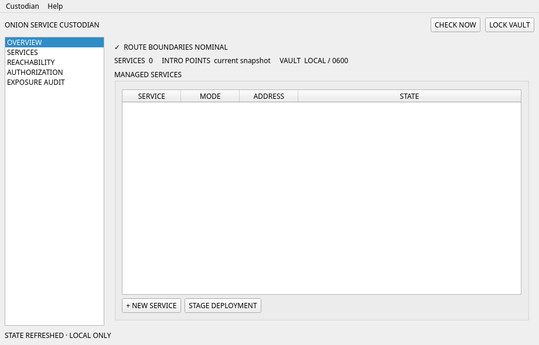

# Onion Service Custodian

Native PySide6/Qt desktop application for safely operating personal v3 onion services. It launches from KDE's application menu as **Onion Service Custodian** through `onion-custodian.desktop`. It does not use Electron and does not open a browser window. `onion_custodian_app.py` is the application entrypoint; `custodian.py` is the local operator backend.

Onion Service Custodian is a small, local-first operations desk for people who run personal onion services and want the boundary between Tor and clearnet to remain visible. It treats identity keys as custody material, makes route modes explicit, requires confirmation for deployment and rotation, and keeps monitoring output aggregate by default.




The interface is compact and monochrome with a classic Macintosh control-panel feel. It exposes service identities, route boundaries, reachability, client authorization, exposure audit, minimal config export, and guarded deployment staging.

Backend commands:

```text
python3 custodian.py add journal --mode onion-only --backend 127.0.0.1:8080 --generate
python3 custodian.py add private-api --mode onion+clearnet --backend 127.0.0.1:8080
python3 custodian.py audit --live
python3 custodian.py config --output config.toml
python3 custodian.py torrc --output reviewed.torrc
python3 custodian.py deploy --confirm
python3 custodian.py deploy --confirm --foreground
python3 custodian.py probe --cookie-file PATH
python3 custodian.py intro-health journal --cookie-file PATH
python3 custodian.py reach journal
python3 custodian.py auth add private-api laptop --file client.auth
python3 custodian.py auth revoke private-api laptop --confirm
python3 custodian.py rotate private-api --confirm
python3 custodian.py tui
```

Modes are explicit and mutually meaningful:

- `onion-only` — backend reachable through Tor only.
- `onion+clearnet` — two public routes to the same service; always reviewed.
- `clearnet-redirect` — clearnet redirects to an onion address and has no backend.

The backend generates v3 identities through Tor, keeps state under restrictive permissions, stores authorization files in each service's `authorized_clients` directory, and never prints secret material. Deployment requires confirmation, blocks unresolved identities and mixed-backend routes by default, verifies Tor's config, and only starts Tor with `--foreground`. The browser files remain as an optional visual reference; they are not the application entrypoint.

Verification: `python3 -m unittest -v`, `python3 -m py_compile custodian.py onion_custodian_app.py`, and `desktop-file-validate onion-custodian.desktop`.
