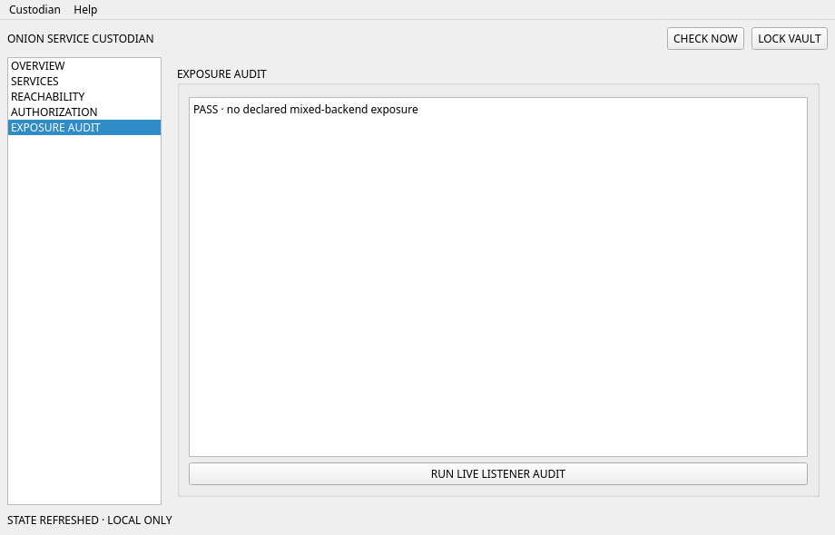

# Onion Service Custodian




Onion Service Custodian is a compact native PySide6/Qt application for safely operating personal v3 onion services. It launches from KDE’s application menu as **Onion Service Custodian** through [`onion-custodian.desktop`](onion-custodian.desktop). It does not use Electron, browser embedding, or a web server.

It is a local-first operations desk for people who run personal onion services and want the boundary between Tor and clearnet to remain visible. It treats identity keys as custody material, makes route modes explicit, requires confirmation for deployment and rotation, and keeps monitoring output aggregate by default.

## What it covers

- real Tor-backed v3 identity generation with restrictive permissions
- reviewed v3 `torrc` rendering and guarded deployment
- cookie-authenticated Tor bootstrap monitoring
- SOCKS5 TCP-only onion reachability probes
- introduction-point descriptor health counts
- client authorization files in each service’s `authorized_clients` directory
- confirmed identity rotation with archived old identities and stale-client marking
- live `ss -ltnH` audit for wildcard backend listeners
- minimal redacted reproducible config export
- native Qt desktop panels plus a curses TUI

## Route modes

- `onion-only` — backend reachable through Tor only.
- `onion+clearnet` — two public routes to the same service; always reviewed.
- `clearnet-redirect` — clearnet redirects to an onion address and has no backend.

The audit warns when the same backend appears behind both onion-only and onion+clearnet routes, and deployment blocks that condition unless explicitly acknowledged.

## Run

Launch **Onion Service Custodian** from the KDE application menu, or run:

```bash
python3 onion_custodian_app.py
python3 custodian.py tui
```

Useful backend commands:

```bash
python3 custodian.py add journal --mode onion-only --backend 127.0.0.1:8080 --generate
python3 custodian.py audit --live
python3 custodian.py config --output config.toml
python3 custodian.py deploy --confirm
python3 custodian.py probe --cookie-file PATH
python3 custodian.py intro-health journal --cookie-file PATH
python3 custodian.py reach journal
python3 custodian.py auth add journal laptop --file client.auth
python3 custodian.py rotate journal --confirm
```

## Safety model

Tor generates the v3 identity in a 0700 local directory; secret keys, authorization files, and state are 0600. Secret values are never printed. Deployment requires `--confirm`, verifies Tor’s generated config, and starts Tor only with `--foreground`. The default workflow stages local state and produces reviewed artifacts; it does not silently restart a system Tor service.

## Verification

```bash
python3 -m unittest -v
python3 -m py_compile custodian.py onion_custodian_app.py
desktop-file-validate onion-custodian.desktop
```
