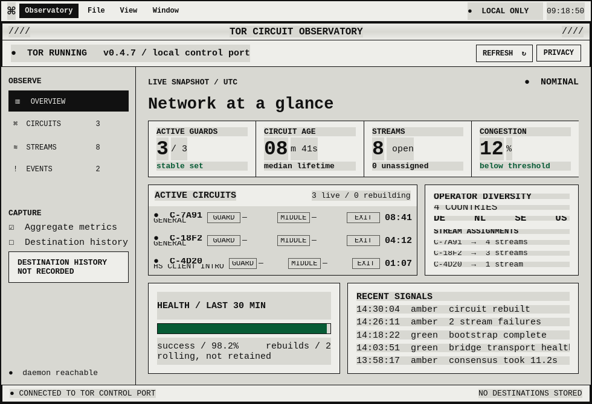

# Tor Circuit Observatory



A compact, native PyQt6 desktop monitor for Tor itself. It uses no Electron, browser window, web server, or destination-history database. The interface keeps a 90s/00s Macintosh control-panel feel while making Tor network behavior legible at a glance.

## What it shows

- current guard set and circuit lifetime
- circuit paths and stream-to-circuit assignments
- country/operator/relay diversity
- congestion, failures, and rebuild signals
- bootstrap completion and bridge transport health
- rolling health signals with no retained destination history

The included values are representative demo telemetry until a Tor control-port adapter is connected. The native UI intentionally does not display or persist destination addresses, hostnames, or stream history.

## Run

Launch **Tor Circuit Observatory** from KDE’s application menu, or run:

```bash
./tor_observatory.py
```

The launcher definition is included at [`tor-circuit-observatory.desktop`](tor-circuit-observatory.desktop). Installing it to `~/.local/share/applications/` makes it available in the application menu.

## Requirements

- Python 3
- PyQt6

## Verification

```bash
python3 -m py_compile tor_observatory.py
desktop-file-validate tor-circuit-observatory.desktop
```
